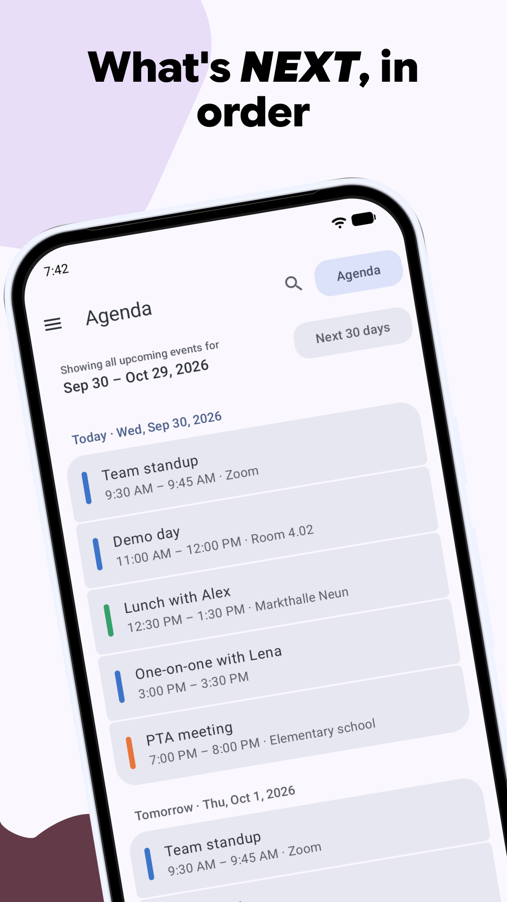
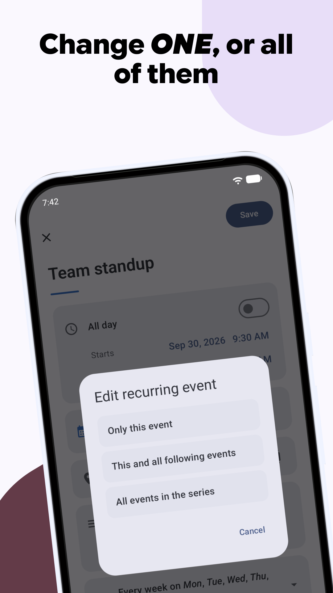
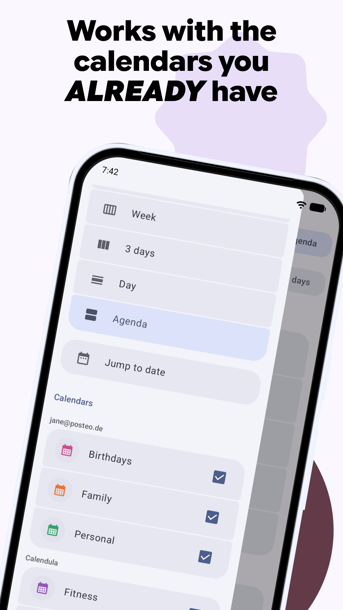
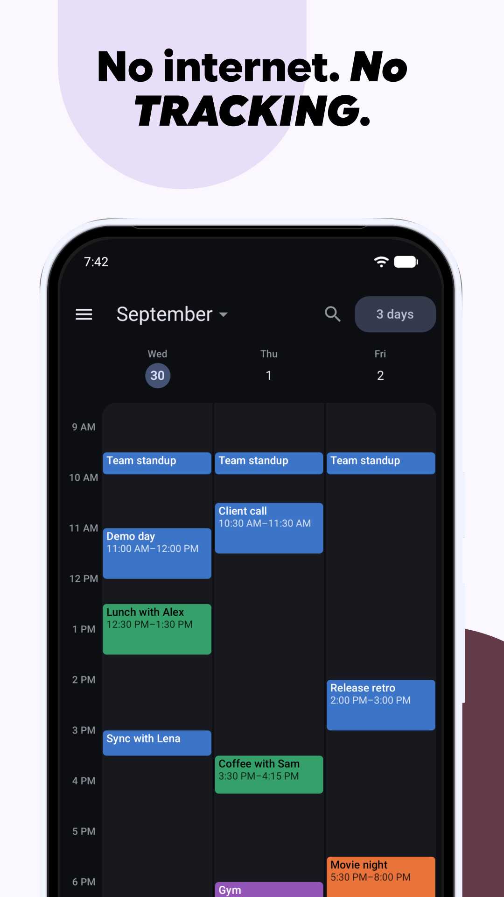

<div align="center">


<h1>Calendula</h1>

<p><strong>A Material 3 Expressive calendar for Android.</strong><br>
It works on top of the system calendar and has no network access.</p>

<p>
<a href="https://codeberg.org/jlmakiola/calendula/actions"></a>


<a href="LICENSE"></a>
</p>

<p>
<a href="https://f-droid.org/packages/de.jeanlucmakiola.calendula/"></a>
&nbsp;
<a href="https://play.google.com/store/apps/details?id=de.jeanlucmakiola.calendula"></a>
&nbsp;
<a href="https://apps.obtainium.imranr.dev/redirect?r=obtainium://add/https://codeberg.org/jlmakiola/calendula"></a>
&nbsp;
<a href="https://ko-fi.com/jeanlucmakiola"></a>
</p>

<p>
&nbsp;
&nbsp;
&nbsp;
&nbsp;
&nbsp;
&nbsp;

</p>

</div>

Calendula is named after the flower. Both its name and the word *calendar*
come from the Latin *kalendae*, the first day of the month.

The app works directly on Android's `CalendarContract`. Any calendar synced to
your device (CalDAV via DAVx5, Google, local, WebCal subscriptions) shows up in
Calendula, and whatever you create or edit syncs back the same way. Calendula
has no database or sync code of its own.

## Features

### Calendar

- Month, week and day views, with a switcher in the top bar
- Event details with attendees and their responses, reminders, recurrence in
  plain words, availability, visibility and foreign time zones
- Calendars can be shown or hidden one by one, grouped by account
- Your contacts' birthdays, anniversaries and other dates, if you turn it on.
  Contacts are read on the device and never changed.

### Editing

- Create, edit and delete events. For a recurring event you choose whether a
  change applies to *only this event*, *this and all following*, or *the whole
  series*.
- The repeat picker has presets and custom rules (interval, weekdays, end
  condition). Rules it can't show are kept as they are.
- If an event changed elsewhere while you were editing it, Calendula asks
  before saving over it.
- Read-only calendars such as WebCal subscriptions and birthdays are detected
  and can't be edited by accident.

### Reminders

- Calendula shows event reminders as notifications itself. Android leaves
  reminder delivery to calendar apps, so if Calendula is your only one, this is
  where your reminders come from.
- Tapping a reminder opens the event.

### Design and privacy

- Material 3 Expressive throughout, with dynamic color on Android 12+, light
  and dark themes, and expressive motion and shapes
- Available in 16 languages, with a per-app language setting.
  [Help translate](#translations).
- No telemetry, no analytics and no internet permission. Your data stays on
  the device.

## Install

All channels install the same app:

| Channel | Updates | Notes |
| --- | --- | --- |
| [Official F-Droid](#f-droid-recommended) | On F-Droid's build schedule | Recommended; no extra setup |
| [Self-hosted F-Droid repo](#self-hosted-f-droid-repo-fastest-updates) | Minutes after a release | Fastest; add the repo once |
| [Codeberg release / Obtainium](#codeberg-release--obtainium) | Per release | Plain APK download, or automatic with Obtainium |
| [Google Play](#google-play) | Per release | Signed with Google's key, see below |
| [Build from source](#build-from-source) | Whenever you build | Full control |

### F-Droid (recommended)

Calendula is in the official [F-Droid](https://f-droid.org) repository. Search
for Calendula in any F-Droid client, or
[install it from f-droid.org](https://f-droid.org/packages/de.jeanlucmakiola.calendula/).

F-Droid builds from source on its own schedule, so a new version usually shows
up there a few days after release.

### Self-hosted F-Droid repo (fastest updates)

The release pipeline builds, signs and publishes every release to a
self-hosted F-Droid repository, so new versions land there first. Add it once
and your F-Droid client handles updates from then on:

1. In your F-Droid client, open *Settings → Repositories → Add* (or open the
   link below on your phone):

   ```
   https://apps.dev.jeanlucmakiola.de/dev/fdroid/repo?fingerprint=C2C0640402BF458FC0ED957AF0B37AA4C14022E72F89CE90B5965B458CF73425
   ```

   <sub>Repo: `https://apps.dev.jeanlucmakiola.de/dev/fdroid/repo` ·
   fingerprint (SHA-256):
   `C2C0 6404 02BF 458F C0ED 957A F0B3 7AA4 C140 22E7 2F89 CE90 B596 5B45 8CF7 3425`</sub>

2. Refresh, search for Calendula and install it.

### Codeberg release / Obtainium

Every release is also on
[Codeberg](https://codeberg.org/jlmakiola/calendula/releases) with the signed
APK (`calendula_vX.Y.Z.apk`) and a `.sha256` checksum. Download it and install
it directly.

For automatic updates from Codeberg, use
[Obtainium](https://github.com/ImranR98/Obtainium). On your phone,
[add Calendula in one tap](https://apps.obtainium.imranr.dev/redirect?r=obtainium://add/https://codeberg.org/jlmakiola/calendula),
or add it by hand: *Add App*, paste `https://codeberg.org/jlmakiola/calendula`,
then *Add*. Obtainium then watches the releases and tells you when a new one
is out.

### Google Play

Calendula is on
[Google Play](https://play.google.com/store/apps/details?id=de.jeanlucmakiola.calendula).

Play builds are signed with Google's key rather than mine, so switching between
Play and any other channel means uninstalling first. You lose the app settings.
Your events live in the system calendar and aren't affected.

### Build from source

It's a plain Gradle build with no proprietary dependencies. See
[docs/BUILDING.md](docs/BUILDING.md), and note the `floret-kit` submodule.

<sub>Official F-Droid, the self-hosted repo and the Codeberg releases share the
same signing key, so you can switch between them without reinstalling. Google
Play is the exception (see above).</sub>

## Documentation

- [Contributing](CONTRIBUTING.md): how to report bugs, propose features and send patches
- [Building from source](docs/BUILDING.md): requirements and Gradle tasks
- [Architecture](docs/ARCHITECTURE.md): the layers and the main pipelines
- [Milestones](https://codeberg.org/jlmakiola/calendula/milestones): what has shipped and what's next
- [Privacy policy](docs/PRIVACY.md): the source of the page at
  [jeanlucmakiola.de/calendula/privacy](https://jeanlucmakiola.de/calendula/privacy)

## Contributing

Bug reports, ideas and patches are welcome on
[Codeberg](https://codeberg.org/jlmakiola/calendula/issues).

Start with an issue. A feature gets a yes or no before anyone writes code, and
features and bugs are assigned a milestone whose `release/vX.Y.Z` branch your
pull request targets. Typo and docs fixes can go straight to a pull request.
Translations go through [Weblate](#translations), not pull requests.

Read [CONTRIBUTING.md](CONTRIBUTING.md) before writing code. It covers the
workflow, the build (including the `floret-kit` submodule) and the
architectural rules changes are reviewed against.

## Translations

Calendula is written in English. Translators on Weblate have added Arabic,
Belarusian, Chinese (Simplified), Czech, French, German, Hungarian, Italian,
Japanese, Polish, Portuguese (Portugal and Brazil), Russian, Slovak and Spanish,
some of them partly. Untranslated strings fall back to English, so a partial
translation is fine. Translations are managed on a self-hosted Weblate:

[Help translate Calendula](https://weblate.dev.jeanlucmakiola.de/engage/calendula/)

You don't need to code. Register on the Weblate server, pick a language (or
request one) and translate in your browser. The app links here from the top of
*Settings → App language*.

## Privacy

Calendula has no analytics, tracking, ads, crash-reporting SDK or third-party
services. It doesn't have the internet permission, so it can't send anything
anywhere. Your events stay in Android's own calendar store.

[Privacy policy](https://jeanlucmakiola.de/calendula/privacy), written in
[`docs/PRIVACY.md`](docs/PRIVACY.md), which is what that page renders.

## License

[MIT](LICENSE), Jean-Luc Makiola, 2026
