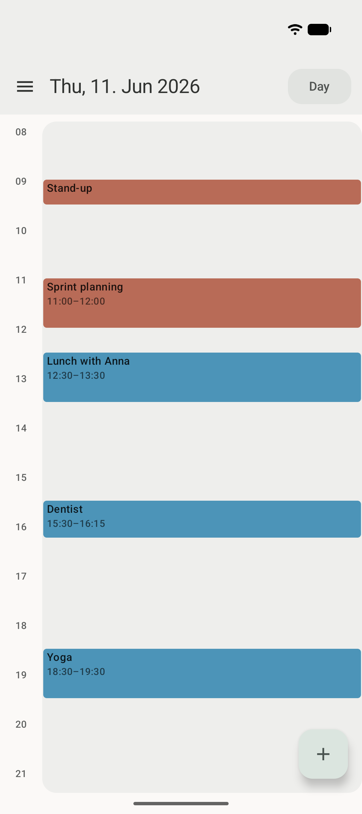
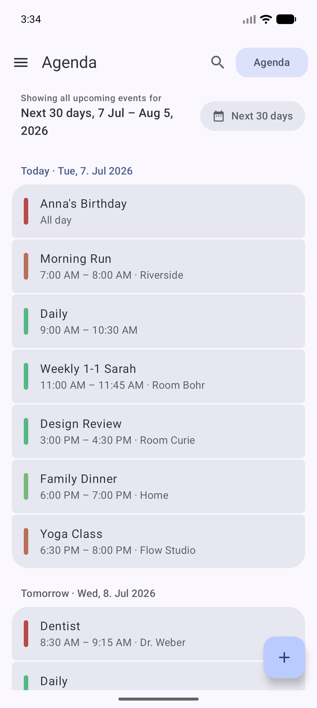

<div align="center">


<h1>Calendula</h1>

<p><strong>A modern Material 3 Expressive calendar for Android.</strong><br>
Reads, writes, and reminds — on top of the system calendar, with zero network access.</p>

<p>
<a href="https://codeberg.org/jlmakiola/calendula/actions"></a>


<a href="LICENSE"></a>
</p>

<p>
<a href="https://f-droid.org/packages/de.jeanlucmakiola.calendula/"></a>
&nbsp;
<a href="https://codeberg.org/jlmakiola/calendula/releases"></a>
&nbsp;
<a href="https://ko-fi.com/jeanlucmakiola"></a>
</p>

<p>
&nbsp;
&nbsp;
&nbsp;
&nbsp;
&nbsp;

</p>

</div>

Calendula is named after the flower whose name — like the word *calendar* —
comes from the Latin *kalendae*, the first day of the month. It lives
entirely on top of Android's `CalendarContract`: any calendar synced to your
device (CalDAV via DAVx5, Google, local, WebCal subscriptions, …) simply
appears, and everything you create or edit syncs back the same way. No own
database, no sync stack reinvented.

## ✨ Features

**Calendar**

- Month, week, and day views with a one-tap view switcher
- Full event details — attendees and their responses, reminders, recurrence
  (humanized), availability, visibility, foreign time zones
- Per-calendar visibility toggle, grouped by account

**Editing**

- Create, edit, and delete events — including recurring events with scoped
  writes: *only this event*, *this and all following*, or *the whole series*
- Recurrence picker with one-tap presets and custom rules (interval, weekday
  toggles, end conditions); rules it can't express are preserved verbatim
- Conflict-safe saves: if an event changed elsewhere while you were editing,
  Calendula asks instead of silently overwriting
- Read-only calendars (WebCal, birthdays) are detected and respected

**Reminders**

- Event reminders delivered by Calendula itself as notifications —
  essential when it's your only calendar app, since Android delegates
  reminder delivery to calendar apps
- Tap a reminder to land on the event

**Design & privacy**

- Real Material 3 Expressive throughout — dynamic color (Android 12+),
  expressive motion and shapes, light/dark theme
- English and German UI plus community translations (Spanish, French, Italian,
  Polish, and more in progress), per-app language setting — and [open to more
  languages](#-translations)
- **Zero telemetry, zero analytics, no internet permission** — your data
  never leaves the device

## 📦 Install

Pick whichever channel you already use — they all install the same app:

| Channel | Updates | Notes |
| --- | --- | --- |
| [Official F-Droid](#f-droid-recommended) | On F-Droid's build schedule | Recommended; no extra setup |
| [Self-hosted F-Droid repo](#self-hosted-f-droid-repo-fastest-updates) | Minutes after a release | Fastest; needs the repo added once |
| [Codeberg release / Obtainium](#codeberg-release--obtainium) | Per release | Plain APK download, or automated by Obtainium |
| [Google Play](#google-play-coming-soon) | — | Coming soon |
| [Build from source](#build-from-source) | Whenever you build | Full control |

### F-Droid (recommended)

Calendula is on the **official [F-Droid](https://f-droid.org) repository** —
just search for **Calendula** in any F-Droid client, or
[install it from f-droid.org](https://f-droid.org/packages/de.jeanlucmakiola.calendula/).

F-Droid rebuilds from source on its own schedule, so a new version usually
shows up there a few days after release.

### Self-hosted F-Droid repo (fastest updates)

Every release is built, signed, and published to a self-hosted F-Droid
repository as part of the release pipeline, so it lands there first. Add it once
and your F-Droid client handles updates from then on:

1. In your F-Droid client, open *Settings → Repositories → Add* (or open the
   link below on your phone):

   ```
   https://apps.dev.jeanlucmakiola.de/dev/fdroid/repo?fingerprint=C2C0640402BF458FC0ED957AF0B37AA4C14022E72F89CE90B5965B458CF73425
   ```

   <sub>Repo: `https://apps.dev.jeanlucmakiola.de/dev/fdroid/repo` ·
   fingerprint (SHA-256):
   `C2C0 6404 02BF 458F C0ED 957A F0B3 7AA4 C140 22E7 2F89 CE90 B596 5B45 8CF7 3425`</sub>

2. Refresh, search for **Calendula**, install.

### Codeberg release / Obtainium

If you'd rather not use F-Droid at all, every release is also published on
**[Codeberg](https://codeberg.org/jlmakiola/calendula/releases)** with the
signed APK (`calendula_vX.Y.Z.apk`) and a `.sha256` checksum attached — download
and install it directly.

For automatic updates from that channel, use
**[Obtainium](https://github.com/ImranR98/Obtainium)**: *Add App* → paste

```
https://codeberg.org/jlmakiola/calendula
```

→ *Add*. Obtainium tracks the releases and prompts you when a new one appears.

### Google Play (coming soon)

Calendula is on its way to Google Play as an additional channel. It isn't live
yet — this section gets a link once it is. Play builds will be signed with
Google's key rather than mine, so switching between Play and any other channel
will require an uninstall.

> **Testers wanted.** Play requires a round of closed testing before the app can
> go public, and I'm still looking for testers. If you'd like to help, email
> **[business@jeanlucmakiola.de](mailto:business@jeanlucmakiola.de)** with the
> Google account address you want to use — that address is what I need to add you
> to the closed test.

### Build from source

The build is a plain Gradle build with no proprietary dependencies — see
**[docs/BUILDING.md](docs/BUILDING.md)** (note the `floret-kit` submodule).

<sub>Official F-Droid, the self-hosted repo, and the Codeberg releases all share
the same signing key, so you can switch freely between them without
reinstalling.</sub>

## 📚 Documentation

- **[Contributing](CONTRIBUTING.md)** — how to report, propose, and patch
- **[Building from source](docs/BUILDING.md)** — requirements and Gradle tasks
- **[Architecture](docs/ARCHITECTURE.md)** — the layered design and key pipelines
- **[Milestones](https://codeberg.org/jlmakiola/calendula/milestones)** — what's shipped and what's next

## 🤝 Contributing

Bug reports, ideas, and patches are all welcome on
**[Codeberg](https://codeberg.org/jlmakiola/calendula/issues)**.

The short version: **start with an issue.** Features get a yes-or-no before they
get code, and both features and bugs are assigned a milestone whose
`release/vX.Y.Z` branch your pull request then targets. Typo and docs fixes can
skip straight to a pull request. Translations don't go through pull requests at
all — [Weblate owns them](#-translations).

Read **[CONTRIBUTING.md](CONTRIBUTING.md)** before writing code: it covers the
workflow, the build (note the `floret-kit` submodule), and the architectural
rules a change is reviewed against.

## 🌍 Translations

Calendula ships in English and German, with community translations in Arabic,
Chinese, French, Italian, Polish, Portuguese, Russian, and Spanish at varying
degrees of completeness — partial is fine, untranslated strings simply fall back
to English. You're warmly invited to add or finish your language. Translations
are managed on a self-hosted **Weblate**:

**→ [Help translate Calendula](https://weblate.dev.jeanlucmakiola.de/engage/calendula/)**

No coding needed — register on the Weblate server, pick (or request) a language,
and translate the strings in your browser. You can also reach this link in the
app from the top of **Settings → App language**.

## 📜 License

[MIT](LICENSE) — Jean-Luc Makiola, 2026
