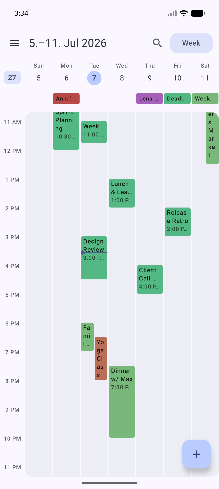
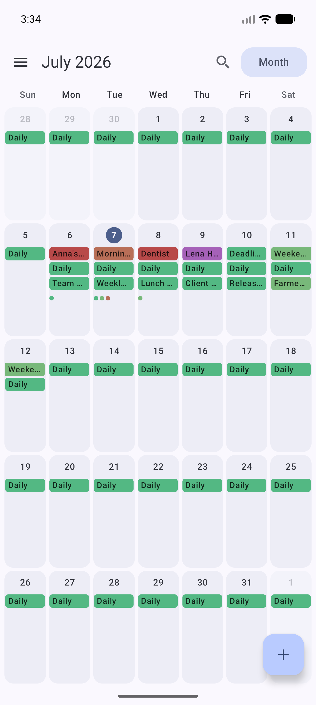
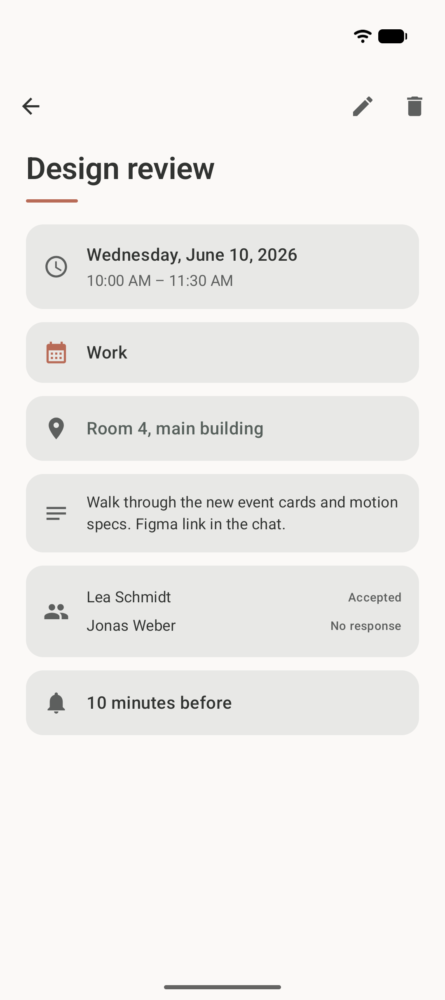
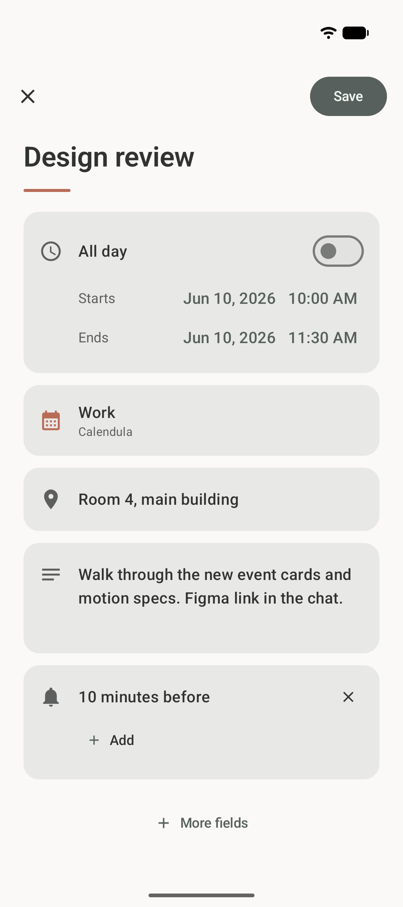
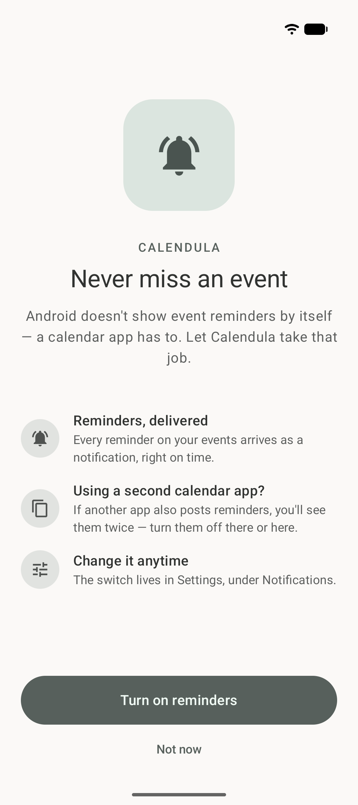

<div align="center">


<h1>Calendula</h1>

<p><strong>A modern Material 3 Expressive calendar for Android.</strong><br>
Reads, writes, and reminds — on top of the system calendar, with zero network access.</p>

<p>
<a href="https://gitea.jeanlucmakiola.de/makiolaj/calendula/actions"></a>


<a href="LICENSE"></a>
</p>

<p>
<a href="https://f-droid.org/packages/de.jeanlucmakiola.calendula/"></a>
&nbsp;
<a href="https://ko-fi.com/jeanlucmakiola"></a>
</p>

<p>
&nbsp;
&nbsp;
&nbsp;
&nbsp;

</p>

</div>

Calendula is named after the flower whose name — like the word *calendar* —
comes from the Latin *kalendae*, the first day of the month. It lives
entirely on top of Android's `CalendarContract`: any calendar synced to your
device (CalDAV via DAVx5, Google, local, WebCal subscriptions, …) simply
appears, and everything you create or edit syncs back the same way. No own
database, no sync stack reinvented.

## ✨ Features

**Calendar**

- Month, week, and day views with a one-tap view switcher
- Full event details — attendees and their responses, reminders, recurrence
  (humanized), availability, visibility, foreign time zones
- Per-calendar visibility toggle, grouped by account

**Editing**

- Create, edit, and delete events — including recurring events with scoped
  writes: *only this event*, *this and all following*, or *the whole series*
- Recurrence picker with one-tap presets and custom rules (interval, weekday
  toggles, end conditions); rules it can't express are preserved verbatim
- Conflict-safe saves: if an event changed elsewhere while you were editing,
  Calendula asks instead of silently overwriting
- Read-only calendars (WebCal, birthdays) are detected and respected

**Reminders**

- Event reminders delivered by Calendula itself as notifications —
  essential when it's your only calendar app, since Android delegates
  reminder delivery to calendar apps
- Tap a reminder to land on the event

**Design & privacy**

- Real Material 3 Expressive throughout — dynamic color (Android 12+),
  expressive motion and shapes, light/dark theme
- German and English UI, per-app language setting
- **Zero telemetry, zero analytics, no internet permission** — your data
  never leaves the device

## 📦 Install

### F-Droid (recommended)

Calendula is on the **official [F-Droid](https://f-droid.org) repository** —
just search for **Calendula** in any F-Droid client, or
[install it from f-droid.org](https://f-droid.org/packages/de.jeanlucmakiola.calendula/).

### Self-hosted repo (latest builds)

New versions are built, signed, and published to a self-hosted repository the
moment each tag lands — usually a few days ahead of the official repo, which
rebuilds on F-Droid's own schedule. Add it for the freshest builds:

1. In your F-Droid client, open *Settings → Repositories → Add* (or open the
   link below on your phone):

   ```
   https://apps.dev.jeanlucmakiola.de/dev/fdroid/repo?fingerprint=C2C0640402BF458FC0ED957AF0B37AA4C14022E72F89CE90B5965B458CF73425
   ```

   <sub>Repo: `https://apps.dev.jeanlucmakiola.de/dev/fdroid/repo` ·
   fingerprint (SHA-256):
   `C2C0 6404 02BF 458F C0ED 957A F0B3 7AA4 C140 22E7 2F89 CE90 B596 5B45 8CF7 3425`</sub>

2. Refresh, search for **Calendula**, install.

Both channels share the same signing key, so you can switch between them
without reinstalling. Or build from source — see below.

## 📚 Documentation

- **[Building from source](docs/BUILDING.md)** — requirements and Gradle tasks
- **[Architecture](docs/ARCHITECTURE.md)** — the layered design and key pipelines
- **[Roadmap](.planning/ROADMAP.md)** — what's shipped and what's next

## 📜 License

[MIT](LICENSE) — Jean-Luc Makiola, 2026
