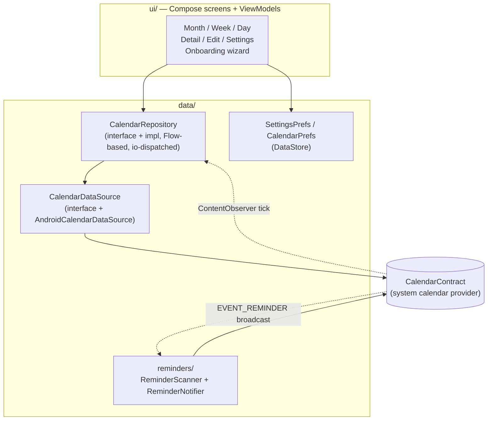
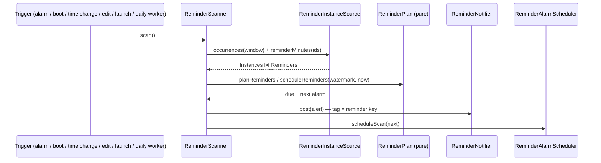

# Architecture

Calendula is a single-activity Jetpack Compose app layered strictly on top
of Android's calendar provider. This document is the orientation tour: the
principles, the layers, and the three pipelines that are not obvious from
the package list (recurring writes, save conflicts, reminder delivery).

## Principles

1. **`CalendarContract` is the single source of truth.** No app database,
   no caching layer, no sync code. Reads query the provider; writes go
   straight back to it. Sync is DAVx5's / Google's / the system's job.
2. **Observer-driven UI.** A `ContentObserver` on the provider triggers
   re-queries; every screen recomposes from fresh provider state. After a
   write, nothing is patched by hand — the provider notifies, the views
   refresh. This also covers external changes (sync) for free.
3. **JVM-first testing.** Everything between the UI and the
   `ContentResolver` is shaped so it runs as a plain JUnit 5 test: pure
   domain logic, cursor-free mappers, a `FakeCalendarDataSource` for
   repository tests. Instrumented tests are a last resort.
4. **No network.** The app declares no `INTERNET` permission. Anything that
   would need one is an explicit, documented product decision first
   (the crash reporter's web-issue path is the worked example).

## Layers

- **`domain/`** — pure Kotlin, no Android imports: models
  (`EventInstance`, `EventDetail`, `CalendarSource`, …), the `EventForm`
  with validation, `SimpleRecurrence` (RRULE parse/render for the picker),
  and `EditSnapshot` (conflict detection). All JVM-tested.
- **`data/calendar/`** — the provider seam. `AndroidCalendarDataSource`
  owns every `ContentResolver` call; cursor parsing lives in mappers
  (`InstanceMapper`, `EventDetailMapper`, `CalendarMapper`) that read
  through a `ColumnReader` abstraction so tests feed them plain maps.
  `EventWriteMapper` builds dirty-checked update value sets. `TimeBridge`
  converts provider epoch millis ↔ `kotlin.time.Instant`.
- **`data/reminders/`** — the notification pipeline (see below). Kept out
  of `data/calendar/` because the receiver needs neither the repository
  nor its flows.
- **`data/prefs/`** — DataStore-backed settings (theme, week start, form
  field defaults, reminders toggle) and small state (last-used calendar).
- **`ui/`** — one package per screen, each with Screen + ViewModel +
  UiState. Shared pieces in `ui/common/` (recurrence humanizer, FAB column,
  drawer, transitions). Selection pickers are full-screen and come from
  floret-kit (`FullScreenPicker` / `OptionPicker`); `AlertDialog` is reserved
  for plain confirmations and the compact recurring-scope choosers.
  `ui/settings/` is the exception to "one file per screen": one
  `SettingsViewModel` feeds a hub (`SettingsScreen.kt`) plus a sub-screen per
  category, each in its own `*Settings.kt`.
- **`floret-kit/`** — the shared Material 3 Expressive kit for the Floret app
  family, wired in as a git submodule *and* a Gradle composite build
  (`includeBuild`), so it is compiled from source rather than resolved as a
  dependency. Pickers, crash plumbing, and locale/time helpers live there;
  changing them is a pull request against that repository plus a submodule bump.

## Navigation

There is no navigation library. `MainActivity` hosts `RootScreen`, which
gates on the first-launch wizard (`ui/onboarding/`), then shows
`CalendarHost`. `CalendarHost` holds the active view (month/week/day)
plus overlay state for detail, edit, and settings — full-screen overlays
driven by `AnimatedVisibility` with a *held-key* pattern: the last shown
key stays alive through the slide-out so content never flashes empty.
A tapped reminder notification routes through `MainActivity` (`singleTop` +
`onNewIntent`) as an external detail key that `CalendarHost` consumes
exactly like an event tap.

### First-launch wizard

`ui/onboarding/` is a plan, not a navigation graph: `onboardingPlan()` is a
pure function of the stored answers that returns the whole flow *plus* the
step it is on, and `RootScreen` renders that step. Two rules make it work:

- The plan keeps **completed** steps, so finishing one never renumbers the
  counter under the user, and stepping *back* is just clearing the previous
  step's answer — there is no separate back stack. The calendar grant is the
  one step with nothing to return to, so back stops there.
- The optional steps (backup, view) only exist for an install still on its
  first run — `armOnboardingWizard()` arms on any launch holding the calendar
  permission but refuses if the reminder step was already answered, and the
  closing screen clears the flag again, so revoking and re-granting the
  permission later never re-onboards anyone.

Whether the backup step applies (nothing writable is synced anywhere) cannot
be known before the grant, so it is assumed until the calendar list can be
read: the flow may shrink after the grant, never sprout a step the counter
had not accounted for.

The flow closes on an "all set" screen, and the one-time calendar-visibility
notice (#75) is a step in front of it rather than a dialog over the app — it
is the only optional step an *already onboarded* install can be given, which
is why it alone is not gated on the wizard being armed.

"Every calendar is switched off" is a *state*, not that announcement, so it
is a step of its own at the front of the flow (#287) rather than another face
of the notice: the notice is settled once and for good, while the state is
derived from the live calendar list on every launch. It lists the calendars
with their own switches — switching one on un-hides it in every other calendar
app too, which is not a choice to make on the app's word — and it sits *in
front of* the calendar step, so declining it falls through to the offer to
make a calendar that a device with none at all gets. That is also why
`calendarsApplies` resolves on "something is visible" rather than "the list is
non-empty". Being derived, it is gated on the wizard being armed: an install
that switched its own calendars off from Settings meant it, and has the in-app
empty state (#239) instead.

## Recurring writes

The provider's invariants drive the design (learned the hard way, verified
on-device):

- Recurring rows carry `RRULE` + `DURATION` (no `DTEND`); one-off rows
  carry `DTEND`.
- *Only this event* → insert a **modified-occurrence exception** via
  `CONTENT_EXCEPTION_URI` (the provider clones the series row, so empty
  optionals are written as explicit NULLs).
- *This and following* → **series split**: insert the new event first (if
  that fails the original is untouched), then truncate the original's
  RRULE with `UNTIL`.
- Truncation updates must send the **complete time-column set**
  (`DTSTART`/`DURATION`/`RRULE`/`ALL_DAY`/`EVENT_TIMEZONE`) — the provider
  regenerates cached instances only from the values carried by the update
  itself; an RRULE-only update leaves stale instances behind.
- `UNTIL` is written as the local end of the previous day expressed in
  UTC, so zones ahead of UTC can't leak an extra occurrence.
- All-day events are normalised to UTC midnights with an exclusive end.

### Drag to reschedule

Dropping an event on another slot (#68) is not a second write path: the drop
loads the event, prefills the **same** `toEditForm` the edit screen uses, shifts
it (`EventShift.kt`), and dispatches through the same three repository calls a
save does — so recurring writes, reminder reconciliation and attendee
preservation behave identically. The full form is carried through, never a
stripped one: `updateOccurrence` reconciles reminders *and* attendees onto the
new exception row, and a partial form would wipe them.

Two things the drag has to get right that the edit screen sidesteps:

- **`RRULE` day parts go stale.** `buildEventUpdateValues` writes the rule
  verbatim while `DTSTART` moves, so dragging a `FREQ=WEEKLY;BYDAY=MO` occurrence
  onto a Wednesday under *All events* leaves a Wednesday anchor under a Monday
  rule and the series does not move. `realignRecurrence` re-derives `BYDAY`, and
  returns **null** for everything else — the drop then offers only *this event*,
  whose exception row carries no rule at all. The same staleness is reachable
  from the edit screen; wiring it there too is a separate change.

  What the rule has to agree with is the **series anchor**, not the occurrence
  being dragged, and `buildEventUpdateValues` moves that anchor by the same
  *wall-clock* shift. So the realigner only touches weekday, which is uniform mod
  7 and therefore survives that shift whatever time of day the anchor sits at.
  Day-of-month is not uniform — `BYMONTHDAY=28` with a January anchor, occurrence
  Feb 28 dragged to Mar 1, would leave a Jan 29 anchor under a `BYMONTHDAY=1`
  rule, a DTSTART that is not an instance of its own rule and a phantom
  occurrence on any client that trusts it.

  Uniform mod 7 is not enough on its own: the anchor also has to cross the *same
  number of midnights* as the occurrence did, or the rebuilt weekday is off by a
  day. `RescheduleViewModel` requires that of every write wider than one
  occurrence, in the two shapes a drag comes in:

  - a drag that **changes the day** must be a whole number of days, so the two
    move in step whatever the anchor's time of day;
  - a **time-only** drag must leave the anchor on its own day. That is normally
    free, since the anchor shares the occurrence's time of day — but a row with
    no `EVENT_TIMEZONE` resolves anchor and occurrence in zones that can sit a
    DST hour apart, and a near-midnight drag would then carry the anchor across a
    midnight the occurrence never crossed.

  Whatever falls outside — a rule the realigner won't rebuild, or a shift that
  would move rule and anchor out of step — may only move the one occurrence.

  The accepted parts are deliberately a **subset** of what `parseSimpleRecurrence`
  understands, so anything realignable is also a rule whose `UNTIL` the guard
  below can actually read.
- **The eligibility gate is load-bearing.** Nothing below the UI refuses a
  write, so `CalendarSource.allowsEventMove` is what keeps read-only and
  contact-managed events from being dragged. It is deliberately *not*
  `isEventTarget`: a managed event is editable (reminders, notes) yet must never
  move, while a switched-off calendar renders nothing to grab anyway.

A drop that would push a series past its own `UNTIL` — the provider then
generates zero occurrences and the event vanishes from every view — is refused
rather than written. The check happens at **write** time, not at drop time,
because which date has to clear `UNTIL` depends on how far the write reaches: a
whole-series move carries the *anchor*, a split starts a new series at the moved
occurrence, and a single occurrence becomes an exception row that no `UNTIL`
constrains. Testing the occurrence in every case would refuse the perfectly
ordinary drag of a bounded series' last occurrence.

**One drop is written at a time.** Two drops of the same recurring event landing
inside one write window would each compute their shift from the same pre-move
occurrence, while the data layer applies both to the re-read anchor — so the
shifts would compound. `RescheduleViewModel.move` therefore refuses while a write
(or its scope dialog) is outstanding, and says so in its return value: the view
that took the drop releases the block it was holding on the target instead of
waiting out a settle that will never arrive.

Two known limitations of a whole-series move, both shared with the edit screen's
own *All events* time save rather than introduced here — a drag just makes them
one gesture away: the series' `EXDATE` stamps and its exception rows are **not**
re-anchored, so previously deleted occurrences can reappear and previously
modified ones stay behind while the rest of the series moves.

### Event time zones

`EventForm.timezone` is the zone its wall-clock times mean, and **null means
"the device zone at save time"** — not "no zone". The data layer resolves it in
`toWriteTimes` and always stamps a concrete `EVENT_TIMEZONE`, so an ordinary
event behaves exactly as it did before the field existed.

- A non-null value **pins** the event: it keeps tracking that zone's offset
  across DST no matter where the device is. `toEditForm` only pins when the
  stored zone differs from the device's, so the optional Time-zone field stays
  hidden on ordinary events and reveals itself (via `populatedFields`) on
  foreign-zone ones.
- A pinned event is prefilled **in its own zone**, so the form shows the
  wall-clock the event means rather than the device's rendering of it.
- A zone change counts as a **time change** even with the wall-clock untouched
  (same 09:00 elsewhere is a different instant), so `buildEventUpdateValues`
  includes it in `timesChanged` and rewrites `DTSTART`.
- **All-day events never carry a zone.** They're date-anchored — the UTC
  midnights above are an anchor, not a location — so the field is withheld from
  the form entirely and `toWriteTimes` forces `"UTC"` regardless.

Still device-zone-relative, and knowingly so: `RRULE`'s `UNTIL` rendering and
`AllDayReminderEncoding`'s offset (see its KDoc).

## Save conflicts

No locking. `openForEdit` keeps an `EditSnapshot` — the prefilled form
*plus the raw Events-row times* (the form derives its times from the tapped
occurrence, so a remotely moved event would otherwise be invisible to it).
Right before writing, the event is re-read and snapshots compared: a
mismatch parks the save in an overwrite/discard dialog; a vanished event
informs and closes. Overwrite still writes only dirty fields, so external
changes to untouched fields survive either way. Fields the form cannot
write (attendees, status, reminder methods) are excluded so sync noise
can't fake a conflict.

A **dropped** event gets no conflict dialog, deliberately. Its blast radius is
already bounded by the same dirty check — only `ALL_DAY`, `EVENT_TIMEZONE`,
`DTSTART` and `DTEND`/`DURATION`/`RRULE` are written — so a concurrent remote
edit to the title, notes or guests survives untouched. What a drop *can* clobber
is a concurrent remote **time** change, and parking a one-gesture action behind a
modal would cost more than that case is worth; the undo on the confirmation chip
is the answer instead. Undo restores semantics, not the row's byte
shape (`DURATION` normalises to `P<n>S`/`P<n>D`, `EVENT_TIMEZONE` is stamped
concrete), and it is offered only where the inverse is one symmetric write — a
one-off event or a whole-series shift. *This event* leaves an exception row
behind and *this and following* splits the series; neither is undone by shifting
back, so both get a plain confirmation. Two further gaps, both narrow and
accepted: a shift whose *anchor* crosses a DST gap is not invertible in wall
clock (the −Δ normalises back to where it started), and an undo after a
concurrent remote time change overwrites it, exactly as the forward move would.

## Reminder delivery

Calendula plans and fires its own reminders. It reads the offsets in
`Reminders` as data, works out when each occurrence's reminder is due, and holds
**one** exact alarm for the earliest one still ahead:

**Why not the provider's broadcast.** It used to schedule the alarms, write the
`CalendarAlerts` rows and broadcast `EVENT_REMINDER`, and the app only reacted.
That chain holds on stock Android and demonstrably not everywhere: AOSP's own
unbundled calendar carries three separate workarounds for OEM providers that
retarget the broadcast or only write the alert row at alert time. A reacting app
cannot tell "nothing was due" from "the broadcast never came" (#75) — and the
reporter's silent events were in a calendar Calendula created itself, so
`VISIBLE` was never the cause there.

**The watermark replaces `CalendarAlerts.STATE`.** A scan posts the reminders
whose moment falls in `(lastScan, now]`, then moves the mark
(`ReminderStatePrefs`). Half-open, so a scan that runs twice cannot post twice,
while a scan that runs *late* still posts what the missed alarm owed — a reboot,
an app update or a doze window costs nothing. A first-ever scan claims the
present rather than the epoch, and a watermark left in the future by a clock
change is clamped. Every trigger runs the same idempotent `scan()`, so there is
no ordering between them to get wrong; `BOOT_COMPLETED` and `MY_PACKAGE_REPLACED`
matter because both wipe pending alarms. Turning reminders off cancels the alarm
and granting the calendar permission arms none, so those transitions scan too —
without it, switching reminders back on would sit silent until the daily worker.
The window a scan reads is the 7-day lookahead plus the longest reminder offset
in the provider, capped at a year: that offset is whatever the largest row says,
including one imported from a stray `TRIGGER:-P100W`.

**All-day reminders fire at the hour the setting names.** The stored offset is
not a plain lead time — `AllDayReminderEncoding` folds a wall-clock hour into it,
sampled against one date's UTC offset — so taking it at face value drifts by the
offset delta across a DST boundary, and rows from other apps carry no hour at
all. The offset is therefore read only for *which day* it means; the hour comes
from the global all-day reminder setting, recomposed against each occurrence's
own date. Which day that is comes from the local date the encoded instant falls
on — except for a plain multiple of 1440, read at face value because a foreign
row means literal days from UTC midnight. The two collide where the all-day hour
equals the zone's UTC offset (20:00 in New York), and there the instant landing
on the named hour decides it is ours; the display path decodes through the same
function, so the screen and the notification agree. Timed reminders need none of
this: `begin` is an absolute instant.

**One visibility model.** The scan only plans occurrences of calendars with
`Calendars.VISIBLE = 1`, and that flag *is* the app's on/off switch: Settings →
Calendars writes it (one calendar per update — `CalendarProvider2` skips its own
`checkNextAlarm()` reschedule for any selection that isn't `_id=`), and every
display predicate reads `CalendarSource.isVisibleInSystem`. The reconciliation
runs one way only: a calendar the user switched off in Calendula is switched off
in the provider, never the reverse — un-hiding one would reach into every other
calendar app on the device — and a one-time notice explains the calendars that
were already off. `CalendarPrefs.pendingDisabledCalendarIds` holds the switch-offs
the app has not been allowed to write yet (read-only permission grant, or a
pre-permission launch); `CalendarVisibilityReconciler` drains it entry by entry,
and until it does, the repository and `ReminderNotifier.post` honour it. That
gate also covers a snooze re-shown from our own alarm after its calendar was
switched off. The drawer's filter sheet (`CalendarPrefs.hiddenCalendarIds`) is a
separate in-app declutter that never touches reminders.

Deliberately absent: a fallback to the provider's `EVENT_REMINDER` broadcast.
Keeping both would double-post wherever the provider works, and Etar's way out —
a latch that disables its own scheduling once a real broadcast arrives — cannot
be copied, because our failure mode includes a broadcast that arrives with no
alert row behind it.

## Importing foreign `.ics`

`IcsParser` is deliberately liberal, because the files it is handed were written
by other people's calendars. What that costs us, learned from reading the Simple
Calendar / Fossify exporter (#225):

**An all-day event may never reach the provider zero days long.** This is what
#225 was: Fossify mirrors Contacts birthdays and anniversaries with
`startTS = endTS` (`MainActivity`), so its exporter's `dayCode(endTS + 12h)`
rounds back to the starting day and writes `DTEND == DTSTART`. Taken literally
that is a yearly series of zero-length occurrences, which the provider expands
into no instances at all — the import reports success and the birthdays are
nowhere. Nothing is logged, because nothing failed. `resolveEnd` floors an
all-day span at a day (also RFC 5545 §3.6.1, which gives a `DATE` `DTSTART` with
no `DTEND` a one-day duration) and `buildImportedEventValues` floors an all-day
`DURATION` at `P1D`.

Do **not** generalise that into correcting the producer's `DTEND` by sniffing its
`PRODID`. The same exporter is right everywhere else: `Event.endTS` anchors a
UI-created all-day event at *noon* of its last day
(`EventActivity.getStartEndTimes`), or at the exclusive midnight when the row
came from CalDAV, and `+ TWELVE_HOURS` rounds either to the following midnight.
Shifting those would push every one of them out by a day. The holiday files
bundled inside Fossify are a second trap: their `PRODID` reads
`Fossify Calendar Holiday Generator` and their content is plain conformant
iCalendar. Both that file and a contact-birthday export are kept as fixtures in
`app/src/test/resources/ics`. Clamp the degenerate case; never rewrite the
conformant one.

**One bad event must not cost the file.** The provider validates `RRULE` through
`EventRecurrence.parse`, which *throws* — out of `insert`, not out of a later
read. That parser works off a fixed table of part names and throws on anything
outside it, so `sanitizeRrule` is a **whitelist**: unrecognised parts (RFC 7529
`RSCALE`, vendor `X-` extensions) and unusable values go, and only a missing
`FREQ` gives up on the rule. It reports whether it actually *dropped* something,
separately from the rule text it returns — case and a trailing `;` normalise away
and must not raise the "faulty repeat rule" warning at the user. Behind all that,
`CalendarRepositoryImpl.importEvents` isolates each event, counting rejects into
`IcsImportSummary.failed` rather than unwinding the batch and reporting only
"couldn't read this file".

Smaller dialect handling: `VTODO` components import as events (Calendula models
no tasks; dropping them silently lost half of some exports), a single-valued
`CATEGORIES` stands in for the `X-WR-CALNAME` Fossify never writes and preselects
a target calendar of that name — as a *fallback* only, since everywhere else the
property is a tag list and must not outrank something that names the calendar
outright — bare `EXDATE` day codes on a timed series are resolved against the
series' own time of day (as is a floating `EXDATE` DATE-TIME — RFC 5545 ties it
to `DTSTART`'s zone, not the device's) while an all-day `EXDATE` keeps the day it
spells out rather than the day its resolved instant lands on in UTC, and an
all-day `VALARM` trigger pointing *after* the start — which is how that family
encodes "on the day at 09:00" — is read as zero days before. On a *timed* event
the same shape means a follow-up alarm and is dropped: clamping it to zero would
invent a reminder at the start that the file never asked for.

All-day reminder offsets are **whole days, rounded up** in both directions. A
file's raw offset is `days × 1440 − timeOfDay`, so rounding to the nearest day
would drop a day for every producer whose all-day notifications fire after noon
("1 day before at 18:00" arrives as `TRIGGER:-PT6H`). The export side is the
mirror image: an all-day row's raw provider `MINUTES` has the firing time encoded
into it and is normally *negative*, which the writer used to discard as a trigger
after the event — so `toIcsEvent` decodes it back through
`fromProviderAllDayMinutes` first, and the importing device re-encodes it against
its own setting.

**A backup carries the series' deleted occurrences.** `EXDATE` lives on the
master row, so the export query's `ORIGINAL_ID IS NULL` filter — which does drop
`RECURRENCE-ID` overrides — never hid it; it simply wasn't read. It is now part
of `EventExportProjection`, and `IcsWriter` marks an all-day series' exclusions
`VALUE=DATE`, because RFC 5545 ties `EXDATE`'s value type to `DTSTART`'s and a
bare day code without it reads as a malformed DATE-TIME. Sync adapters disagree
on whether an all-day exclusion is `yyyyMMdd` or a padded midnight stamp, so
`exportExDates` drops the time part on the way out. Without this, an in-app
backup→restore resurrected every occurrence the user had deleted.

That re-encode is sampled where the reminder will actually *fire*, not at
`DTSTART` (`importedAllDayReminderDate`). An imported series' `DTSTART` is only an
anchor and is routinely ancient — Fossify writes a year-less contact birthday at
1970, and a real birth year is usually older still — from a year whose timezone
rules predate DST across most of Europe. Sampling the UTC offset there skews every
modern occurrence by the delta, the same trap `nextYearlyOccurrence` exists for on
the managed special-dates path. Decoding is unaffected and stays anchored at
`DTSTART`: it only asks which local *day* the encoded instant falls on.

Colour arrives as a raw ARGB from an app with no idea which account it is landing
in. A calendar whose account publishes a palette rejects a raw `EVENT_COLOR`, so
`buildImportedEventValues` snaps the imported colour to the nearest published key
(`nearestTo`, measured in Oklab) and writes the raw value only where there is no
palette. The match runs against `publishedEventColors`, **not** the curated
`eventColorPalette`: curation is a picker concession that folds look-alikes and
drops the neutrals outright from an oversized palette, but every published key is
one the calendar accepts. The single-event review form deliberately keeps no colour at all: its
first question is which calendar to use, and answering it clears the colour
anyway.

## Testing

JUnit 5 + Truth + Turbine on the JVM. The seams that make it work:
`CalendarDataSource` is faked (`FakeCalendarDataSource` records writes),
mappers parse `ColumnReader`/plain maps instead of cursors, domain logic
(recurrence, validation, snapshots, write-value building) is pure. CI
(Forgejo Actions on Codeberg) runs `lint test assembleDebug` once per pull
request; merging a
bumped `versionName` to `main` builds, signs, and publishes to the self-hosted
F-Droid repo and then mints the `vX.Y.Z` tag + release. See docs/RELEASING.md.
