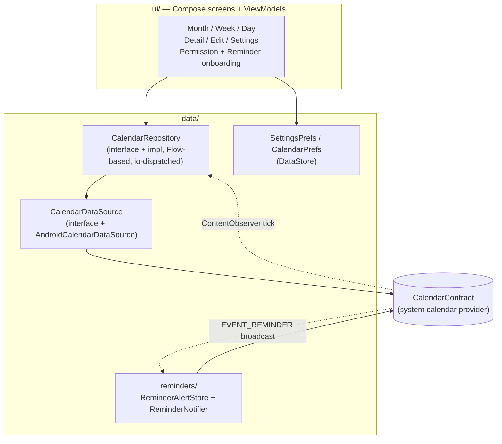
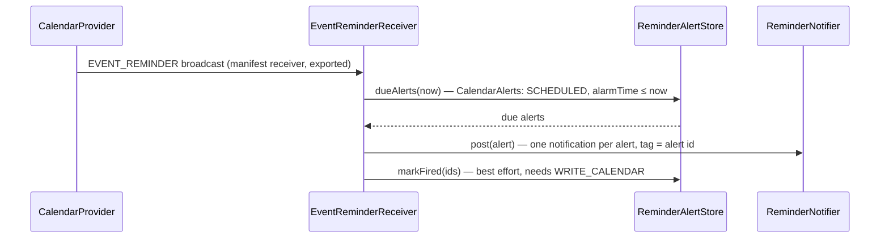

# Architecture

Calendula is a single-activity Jetpack Compose app layered strictly on top
of Android's calendar provider. This document is the orientation tour: the
principles, the layers, and the three pipelines that are not obvious from
the package list (recurring writes, save conflicts, reminder delivery).

## Principles

1. **`CalendarContract` is the single source of truth.** No app database,
   no caching layer, no sync code. Reads query the provider; writes go
   straight back to it. Sync is DAVx5's / Google's / the system's job.
2. **Observer-driven UI.** A `ContentObserver` on the provider triggers
   re-queries; every screen recomposes from fresh provider state. After a
   write, nothing is patched by hand — the provider notifies, the views
   refresh. This also covers external changes (sync) for free.
3. **JVM-first testing.** Everything between the UI and the
   `ContentResolver` is shaped so it runs as a plain JUnit 5 test: pure
   domain logic, cursor-free mappers, a `FakeCalendarDataSource` for
   repository tests. Instrumented tests are a last resort.
4. **No network.** The app declares no `INTERNET` permission. Anything that
   would need one is an explicit, documented product decision first
   (see the roadmap's idea backlog).

## Layers

- **`domain/`** — pure Kotlin, no Android imports: models
  (`EventInstance`, `EventDetail`, `CalendarSource`, …), the `EventForm`
  with validation, `SimpleRecurrence` (RRULE parse/render for the picker),
  and `EditSnapshot` (conflict detection). All JVM-tested.
- **`data/calendar/`** — the provider seam. `AndroidCalendarDataSource`
  owns every `ContentResolver` call; cursor parsing lives in mappers
  (`InstanceMapper`, `EventDetailMapper`, `CalendarMapper`) that read
  through a `ColumnReader` abstraction so tests feed them plain maps.
  `EventWriteMapper` builds dirty-checked update value sets. `TimeBridge`
  converts provider epoch millis ↔ `kotlin.time.Instant`.
- **`data/reminders/`** — the notification pipeline (see below). Kept out
  of `data/calendar/` because the receiver needs neither the repository
  nor its flows.
- **`data/prefs/`** — DataStore-backed settings (theme, week start, form
  field defaults, reminders toggle) and small state (last-used calendar).
- **`ui/`** — one package per screen, each with Screen + ViewModel +
  UiState. Shared pieces in `ui/common/` (OptionCard — the app's only
  sanctioned selection-dialog style —, recurrence humanizer, FAB column,
  drawer, transitions).

## Navigation

There is no navigation library. `MainActivity` hosts `RootScreen`, which
gates on the calendar permission and the one-time reminder onboarding, then
shows `CalendarHost`. `CalendarHost` holds the active view (month/week/day)
plus overlay state for detail, edit, and settings — full-screen overlays
driven by `AnimatedVisibility` with a *held-key* pattern: the last shown
key stays alive through the slide-out so content never flashes empty.
A tapped reminder notification routes through `MainActivity` (`singleTop` +
`onNewIntent`) as an external detail key that `CalendarHost` consumes
exactly like an event tap.

## Recurring writes

The provider's invariants drive the design (learned the hard way, verified
on-device — see plan 03):

- Recurring rows carry `RRULE` + `DURATION` (no `DTEND`); one-off rows
  carry `DTEND`.
- *Only this event* → insert a **modified-occurrence exception** via
  `CONTENT_EXCEPTION_URI` (the provider clones the series row, so empty
  optionals are written as explicit NULLs).
- *This and following* → **series split**: insert the new event first (if
  that fails the original is untouched), then truncate the original's
  RRULE with `UNTIL`.
- Truncation updates must send the **complete time-column set**
  (`DTSTART`/`DURATION`/`RRULE`/`ALL_DAY`/`EVENT_TIMEZONE`) — the provider
  regenerates cached instances only from the values carried by the update
  itself; an RRULE-only update leaves stale instances behind.
- `UNTIL` is written as the local end of the previous day expressed in
  UTC, so zones ahead of UTC can't leak an extra occurrence.
- All-day events are normalised to UTC midnights with an exclusive end.

### Event time zones

`EventForm.timezone` is the zone its wall-clock times mean, and **null means
"the device zone at save time"** — not "no zone". The data layer resolves it in
`toWriteTimes` and always stamps a concrete `EVENT_TIMEZONE`, so an ordinary
event behaves exactly as it did before the field existed.

- A non-null value **pins** the event: it keeps tracking that zone's offset
  across DST no matter where the device is. `toEditForm` only pins when the
  stored zone differs from the device's, so the optional Time-zone field stays
  hidden on ordinary events and reveals itself (via `populatedFields`) on
  foreign-zone ones.
- A pinned event is prefilled **in its own zone**, so the form shows the
  wall-clock the event means rather than the device's rendering of it.
- A zone change counts as a **time change** even with the wall-clock untouched
  (same 09:00 elsewhere is a different instant), so `buildEventUpdateValues`
  includes it in `timesChanged` and rewrites `DTSTART`.
- **All-day events never carry a zone.** They're date-anchored — the UTC
  midnights above are an anchor, not a location — so the field is withheld from
  the form entirely and `toWriteTimes` forces `"UTC"` regardless.

Still device-zone-relative, and knowingly so: `RRULE`'s `UNTIL` rendering and
`AllDayReminderEncoding`'s offset (see its KDoc).

## Save conflicts

No locking. `openForEdit` keeps an `EditSnapshot` — the prefilled form
*plus the raw Events-row times* (the form derives its times from the tapped
occurrence, so a remotely moved event would otherwise be invisible to it).
Right before writing, the event is re-read and snapshots compared: a
mismatch parks the save in an overwrite/discard dialog; a vanished event
informs and closes. Overwrite still writes only dirty fields, so external
changes to untouched fields survive either way. Fields the form cannot
write (attendees, status, reminder methods) are excluded so sync noise
can't fake a conflict.

## Reminder delivery

The provider schedules reminder alarms (for `METHOD_ALERT` rows only) and
broadcasts `EVENT_REMINDER` — but posts no notification; a calendar app
must (the Etar model):

Posting happens before marking: a crash in between re-posts silently (same
tag + `setOnlyAlertOnce`) rather than losing a reminder. Swiped
notifications never return because `FIRED` rows are never re-queried.

**One visibility model.** The provider only schedules alarms for calendars with
`Calendars.VISIBLE = 1`, so that flag *is* the app's on/off switch: Settings →
Calendars writes it (one calendar per update — `CalendarProvider2` skips its own
`checkNextAlarm()` reschedule for any selection that isn't `_id=`), and every
display predicate reads `CalendarSource.isVisibleInSystem`. The reconciliation
runs one way only: a calendar the user switched off in Calendula is switched off
in the provider, never the reverse — un-hiding one would reach into every other
calendar app on the device — and a one-time notice explains the calendars that
were already off. `CalendarPrefs.pendingDisabledCalendarIds` holds the switch-offs
the app has not been allowed to write yet (read-only permission grant, or a
pre-permission launch); `CalendarVisibilityReconciler` drains it entry by entry,
and until it does, the repository and `ReminderNotifier.post` honour it. That
gate also covers a snooze re-shown from our own alarm after its calendar was
switched off. Silencing is not handling: an alert the gate drops keeps its
`SCHEDULED` state while its event is still ahead (`handledAlertIds`), so
switching the calendar back on re-posts it (`ReminderRecovery`) instead of
losing it — the provider's own table is the stash. The drawer's filter sheet
(`CalendarPrefs.hiddenCalendarIds`) is a separate in-app declutter that never
touches reminders.

Deliberately absent until real devices prove it necessary: own alarm
scheduling, `BOOT_COMPLETED`, snooze/dismiss actions, battery-exemption
prompts.

## Testing

JUnit 5 + Truth + Turbine on the JVM. The seams that make it work:
`CalendarDataSource` is faked (`FakeCalendarDataSource` records writes),
mappers parse `ColumnReader`/plain maps instead of cursors, domain logic
(recurrence, validation, snapshots, write-value building) is pure. CI
(Gitea Actions) runs `lint test assembleDebug` once per pull request; merging a
bumped `versionName` to `main` builds, signs, and publishes to the self-hosted
F-Droid repo and then mints the `vX.Y.Z` tag + release. See docs/RELEASING.md.
