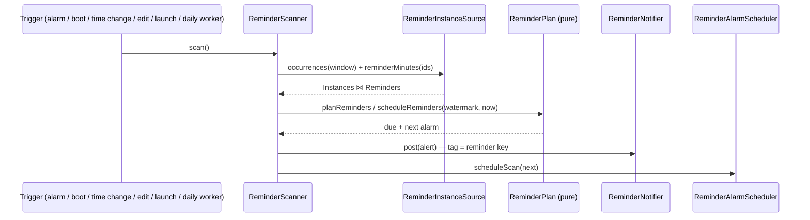

# Architecture

Calendula is a single-activity Jetpack Compose app layered strictly on top
of Android's calendar provider. This document is the orientation tour: the
principles, the layers, and the three pipelines that are not obvious from
the package list (recurring writes, save conflicts, reminder delivery).

## Principles

1. **`CalendarContract` is the single source of truth.** No app database,
   no caching layer, no sync code. Reads query the provider; writes go
   straight back to it. Sync is DAVx5's / Google's / the system's job.
2. **Observer-driven UI.** A `ContentObserver` on the provider triggers
   re-queries; every screen recomposes from fresh provider state. After a
   write, nothing is patched by hand — the provider notifies, the views
   refresh. This also covers external changes (sync) for free.
3. **JVM-first testing.** Everything between the UI and the
   `ContentResolver` is shaped so it runs as a plain JUnit 5 test: pure
   domain logic, cursor-free mappers, a `FakeCalendarDataSource` for
   repository tests. Instrumented tests are a last resort.
4. **No network.** The app declares no `INTERNET` permission. Anything that
   would need one is an explicit, documented product decision first
   (the crash reporter's web-issue path is the worked example).

## Layers

- **`domain/`** — pure Kotlin, no Android imports: models
  (`EventInstance`, `EventDetail`, `CalendarSource`, …), the `EventForm`
  with validation, `SimpleRecurrence` (RRULE parse/render for the picker),
  and `EditSnapshot` (conflict detection). All JVM-tested.
- **`data/calendar/`** — the provider seam. `AndroidCalendarDataSource`
  owns every `ContentResolver` call; cursor parsing lives in mappers
  (`InstanceMapper`, `EventDetailMapper`, `CalendarMapper`) that read
  through a `ColumnReader` abstraction so tests feed them plain maps.
  `EventWriteMapper` builds dirty-checked update value sets. `TimeBridge`
  converts provider epoch millis ↔ `kotlin.time.Instant`.
- **`data/reminders/`** — the notification pipeline (see below). Kept out
  of `data/calendar/` because the receiver needs neither the repository
  nor its flows.
- **`data/prefs/`** — DataStore-backed settings (theme, week start, form
  field defaults, reminders toggle) and small state (last-used calendar).
- **`ui/`** — one package per screen, each with Screen + ViewModel +
  UiState. Shared pieces in `ui/common/` (recurrence humanizer, FAB column,
  drawer, transitions). Selection pickers are full-screen and come from
  floret-kit (`FullScreenPicker` / `OptionPicker`); `AlertDialog` is reserved
  for plain confirmations and the compact recurring-scope choosers.
  `ui/settings/` is the exception to "one file per screen": one
  `SettingsViewModel` feeds a hub (`SettingsScreen.kt`) plus a sub-screen per
  category, each in its own `*Settings.kt`.
- **`floret-kit/`** — the shared Material 3 Expressive kit for the Floret app
  family, wired in as a git submodule *and* a Gradle composite build
  (`includeBuild`), so it is compiled from source rather than resolved as a
  dependency. Pickers, crash plumbing, and locale/time helpers live there;
  changing them is a pull request against that repository plus a submodule bump.

## Navigation

There is no navigation library. `MainActivity` hosts `RootScreen`, which
gates on the calendar permission and the one-time reminder onboarding, then
shows `CalendarHost`. `CalendarHost` holds the active view (month/week/day)
plus overlay state for detail, edit, and settings — full-screen overlays
driven by `AnimatedVisibility` with a *held-key* pattern: the last shown
key stays alive through the slide-out so content never flashes empty.
A tapped reminder notification routes through `MainActivity` (`singleTop` +
`onNewIntent`) as an external detail key that `CalendarHost` consumes
exactly like an event tap.

## Recurring writes

The provider's invariants drive the design (learned the hard way, verified
on-device):

- Recurring rows carry `RRULE` + `DURATION` (no `DTEND`); one-off rows
  carry `DTEND`.
- *Only this event* → insert a **modified-occurrence exception** via
  `CONTENT_EXCEPTION_URI` (the provider clones the series row, so empty
  optionals are written as explicit NULLs).
- *This and following* → **series split**: insert the new event first (if
  that fails the original is untouched), then truncate the original's
  RRULE with `UNTIL`.
- Truncation updates must send the **complete time-column set**
  (`DTSTART`/`DURATION`/`RRULE`/`ALL_DAY`/`EVENT_TIMEZONE`) — the provider
  regenerates cached instances only from the values carried by the update
  itself; an RRULE-only update leaves stale instances behind.
- `UNTIL` is written as the local end of the previous day expressed in
  UTC, so zones ahead of UTC can't leak an extra occurrence.
- All-day events are normalised to UTC midnights with an exclusive end.

### Drag to reschedule

Dropping an event on another slot (#68) is not a second write path: the drop
loads the event, prefills the **same** `toEditForm` the edit screen uses, shifts
it (`EventShift.kt`), and dispatches through the same three repository calls a
save does — so recurring writes, reminder reconciliation and attendee
preservation behave identically. The full form is carried through, never a
stripped one: `updateOccurrence` reconciles reminders *and* attendees onto the
new exception row, and a partial form would wipe them.

Two things the drag has to get right that the edit screen sidesteps:

- **`RRULE` day parts go stale.** `buildEventUpdateValues` writes the rule
  verbatim while `DTSTART` moves, so dragging a `FREQ=WEEKLY;BYDAY=MO` occurrence
  onto a Wednesday under *All events* leaves a Wednesday anchor under a Monday
  rule and the series does not move. `realignRecurrence` re-derives `BYDAY` /
  `BYMONTHDAY` / `BYMONTH` from the new date, and returns **null** for rules one
  moved occurrence cannot resolve (`BYDAY=MO,WE`, `2TH`, `BYSETPOS`) — the drop
  then offers only *this event*, whose exception row carries no rule at all. The
  same staleness is reachable from the edit screen; wiring it there too is a
  separate change.
- **The eligibility gate is load-bearing.** Nothing below the UI refuses a
  write, so `CalendarSource.allowsEventMove` is what keeps read-only and
  contact-managed events from being dragged. It is deliberately *not*
  `isEventTarget`: a managed event is editable (reminders, notes) yet must never
  move, while a switched-off calendar renders nothing to grab anyway.

`EventForm.problems()` runs before the write, so a drop that would push a series
past its own `UNTIL` — which makes the provider generate zero occurrences and the
event vanish — is refused rather than written.

### Event time zones

`EventForm.timezone` is the zone its wall-clock times mean, and **null means
"the device zone at save time"** — not "no zone". The data layer resolves it in
`toWriteTimes` and always stamps a concrete `EVENT_TIMEZONE`, so an ordinary
event behaves exactly as it did before the field existed.

- A non-null value **pins** the event: it keeps tracking that zone's offset
  across DST no matter where the device is. `toEditForm` only pins when the
  stored zone differs from the device's, so the optional Time-zone field stays
  hidden on ordinary events and reveals itself (via `populatedFields`) on
  foreign-zone ones.
- A pinned event is prefilled **in its own zone**, so the form shows the
  wall-clock the event means rather than the device's rendering of it.
- A zone change counts as a **time change** even with the wall-clock untouched
  (same 09:00 elsewhere is a different instant), so `buildEventUpdateValues`
  includes it in `timesChanged` and rewrites `DTSTART`.
- **All-day events never carry a zone.** They're date-anchored — the UTC
  midnights above are an anchor, not a location — so the field is withheld from
  the form entirely and `toWriteTimes` forces `"UTC"` regardless.

Still device-zone-relative, and knowingly so: `RRULE`'s `UNTIL` rendering and
`AllDayReminderEncoding`'s offset (see its KDoc).

## Save conflicts

No locking. `openForEdit` keeps an `EditSnapshot` — the prefilled form
*plus the raw Events-row times* (the form derives its times from the tapped
occurrence, so a remotely moved event would otherwise be invisible to it).
Right before writing, the event is re-read and snapshots compared: a
mismatch parks the save in an overwrite/discard dialog; a vanished event
informs and closes. Overwrite still writes only dirty fields, so external
changes to untouched fields survive either way. Fields the form cannot
write (attendees, status, reminder methods) are excluded so sync noise
can't fake a conflict.

A **dropped** event gets no conflict dialog, deliberately. Its blast radius is
already bounded by the same dirty check — only `ALL_DAY`, `EVENT_TIMEZONE`,
`DTSTART` and `DTEND`/`DURATION`/`RRULE` are written — so a concurrent remote
edit to the title, notes or guests survives untouched. What a drop *can* clobber
is a concurrent remote **time** change, and parking a one-gesture action behind a
modal would cost more than that case is worth; the undo in the confirmation
snackbar is the answer instead. Undo restores semantics, not the row's byte
shape (`DURATION` normalises to `P<n>S`/`P<n>D`, `EVENT_TIMEZONE` is stamped
concrete), and it is offered only where the inverse is one symmetric write — a
one-off event or a whole-series shift. *This event* leaves an exception row
behind and *this and following* splits the series; neither is undone by shifting
back, so both get a plain confirmation.

## Reminder delivery

Calendula plans and fires its own reminders. It reads the offsets in
`Reminders` as data, works out when each occurrence's reminder is due, and holds
**one** exact alarm for the earliest one still ahead:

**Why not the provider's broadcast.** It used to schedule the alarms, write the
`CalendarAlerts` rows and broadcast `EVENT_REMINDER`, and the app only reacted.
That chain holds on stock Android and demonstrably not everywhere: AOSP's own
unbundled calendar carries three separate workarounds for OEM providers that
retarget the broadcast or only write the alert row at alert time. A reacting app
cannot tell "nothing was due" from "the broadcast never came" (#75) — and the
reporter's silent events were in a calendar Calendula created itself, so
`VISIBLE` was never the cause there.

**The watermark replaces `CalendarAlerts.STATE`.** A scan posts the reminders
whose moment falls in `(lastScan, now]`, then moves the mark
(`ReminderStatePrefs`). Half-open, so a scan that runs twice cannot post twice,
while a scan that runs *late* still posts what the missed alarm owed — a reboot,
an app update or a doze window costs nothing. A first-ever scan claims the
present rather than the epoch, and a watermark left in the future by a clock
change is clamped. Every trigger runs the same idempotent `scan()`, so there is
no ordering between them to get wrong; `BOOT_COMPLETED` and `MY_PACKAGE_REPLACED`
matter because both wipe pending alarms. Turning reminders off cancels the alarm
and granting the calendar permission arms none, so those transitions scan too —
without it, switching reminders back on would sit silent until the daily worker.
The window a scan reads is the 7-day lookahead plus the longest reminder offset
in the provider, capped at a year: that offset is whatever the largest row says,
including one imported from a stray `TRIGGER:-P100W`.

**All-day reminders fire at the hour the setting names.** The stored offset is
not a plain lead time — `AllDayReminderEncoding` folds a wall-clock hour into it,
sampled against one date's UTC offset — so taking it at face value drifts by the
offset delta across a DST boundary, and rows from other apps carry no hour at
all. The offset is therefore read only for *which day* it means; the hour comes
from the global all-day reminder setting, recomposed against each occurrence's
own date. Which day that is comes from the local date the encoded instant falls
on — except for a plain multiple of 1440, read at face value because a foreign
row means literal days from UTC midnight. The two collide where the all-day hour
equals the zone's UTC offset (20:00 in New York), and there the instant landing
on the named hour decides it is ours; the display path decodes through the same
function, so the screen and the notification agree. Timed reminders need none of
this: `begin` is an absolute instant.

**One visibility model.** The scan only plans occurrences of calendars with
`Calendars.VISIBLE = 1`, and that flag *is* the app's on/off switch: Settings →
Calendars writes it (one calendar per update — `CalendarProvider2` skips its own
`checkNextAlarm()` reschedule for any selection that isn't `_id=`), and every
display predicate reads `CalendarSource.isVisibleInSystem`. The reconciliation
runs one way only: a calendar the user switched off in Calendula is switched off
in the provider, never the reverse — un-hiding one would reach into every other
calendar app on the device — and a one-time notice explains the calendars that
were already off. `CalendarPrefs.pendingDisabledCalendarIds` holds the switch-offs
the app has not been allowed to write yet (read-only permission grant, or a
pre-permission launch); `CalendarVisibilityReconciler` drains it entry by entry,
and until it does, the repository and `ReminderNotifier.post` honour it. That
gate also covers a snooze re-shown from our own alarm after its calendar was
switched off. The drawer's filter sheet (`CalendarPrefs.hiddenCalendarIds`) is a
separate in-app declutter that never touches reminders.

Deliberately absent: a fallback to the provider's `EVENT_REMINDER` broadcast.
Keeping both would double-post wherever the provider works, and Etar's way out —
a latch that disables its own scheduling once a real broadcast arrives — cannot
be copied, because our failure mode includes a broadcast that arrives with no
alert row behind it.

## Testing

JUnit 5 + Truth + Turbine on the JVM. The seams that make it work:
`CalendarDataSource` is faked (`FakeCalendarDataSource` records writes),
mappers parse `ColumnReader`/plain maps instead of cursors, domain logic
(recurrence, validation, snapshots, write-value building) is pure. CI
(Forgejo Actions on Codeberg) runs `lint test assembleDebug` once per pull
request; merging a
bumped `versionName` to `main` builds, signs, and publishes to the self-hosted
F-Droid repo and then mints the `vX.Y.Z` tag + release. See docs/RELEASING.md.
